  

## Our mission

The frontline no longer stops at the border. It runs through power grids, data centres, factories, depots and hospitals: the sites that keep a country running.

The people defending them are stretched too thin. Too many screens, too few eyes, and incidents they never got the chance to see.

**We are building the force multiplier.** Autonomous robots, every camera and every sensor, fused into one intelligence that sees everything, misses nothing, and tells a single operator exactly where to look. Across many sites. Around the clock.

## Join us

We build systems that work outside the lab, where latency, reliability and failure modes are the job. We hire for robotics, perception, autonomy and infrastructure.

**[Open positions →](https://jobs.ashbyhq.com/laelaps)** &nbsp;·&nbsp; nothing fits? Write to **[talent@laelaps.ai](mailto:talent@laelaps.ai)**

Zürich, Switzerland · [laelaps.ai](https://laelaps.ai) · [LinkedIn](https://www.linkedin.com/company/laelaps-ai/)
